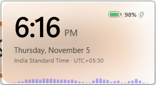

# Prism

A small floating glass widget for Windows 11, built with WinUI 3. It shows the time, date, time zone and battery level, a foldable panel with your Windows notifications and follow-ups, and a tiny audio spectrum analyzer along the bottom edge. The glass is styled after the frosted look of recent macOS versions.

```
┌──────────────────────────────┐
│ 10:42 AM            ▭ 78% ⚡│
│ Thursday, November 5         │
│ India Standard Time·UTC+05:30│
│ 🔔 3 notifications     ★2 ▾ │
│▁▂▆▃▂▄▅▃▂▁▁▂▃▂▁▁▂▃▁▂▅▃▂▁ │
└──────────────────────────────┘

```



## Features

- **Glass look**: Windows Acrylic blur with a light tint, white highlight, soft edge and rounded corners.
- **Clock**: time, full date and local time zone with its UTC offset. Updates automatically when the time zone or daylight saving changes.
- **Battery**: always shown in the top-right corner. The bar is green, then orange at 20% or below, then red at 10% or below. ⚡ appears while charging.
- **Notifications**: a foldable panel listing the notifications in the Windows Notification Center, from all apps, grouped by app like the Notification Center. Dismiss one or clear all. Needs a one-time setup (see [Notifications setup](#notifications-setup)).
- **Follow-ups**: star (☆) any notification to follow up on it. Starred items stay until you mark them done, even after the notification is gone. From 5 PM the panel's row turns amber to show how many are left.
- **Audio spectrum**: 40 bars that react to what your speakers are playing, or to your microphone. The strip fades in with sound and out when it's quiet.
- **Floating window**:
  - Drag it anywhere; it remembers its position.
  - Always on top, or a normal window.
  - Lock position.
  - Click-through, so clicks pass to the windows underneath.
  - Four transparency levels.
- **Tray icon**: show or hide the widget, change options, or exit.
- **Start with Windows**: optional.
- Hidden from the taskbar and Alt-Tab. Only one copy runs at a time. Works across multiple monitors with different display scaling.

## Requirements

- Windows 11
- [.NET 10 SDK](https://dotnet.microsoft.com/download) to build from source

## Build and run

```powershell
git clone https://github.com/singingrocket/prism-widget.git
cd prism-widget\Prism
dotnet run
```

To make a standalone copy for everyday use:

```powershell
dotnet publish -c Release -o C:\Prism
C:\Prism\Prism.exe
```

If you want **Start with Windows**, turn it on from the published copy. Prism registers whichever `.exe` is running when you enable it.

## Notifications setup

Windows only lets apps with a package identity read other apps' notifications. Prism stays a normal `.exe`, and a small signed identity package links it to that permission. Run this once from the repository folder (you need administrator rights; approve the UAC prompt):

```powershell
.\Prism\Packaging\Register-Prism.ps1
```

The script:

1. Creates a self-signed code-signing certificate (`CN=singingrocket`) in your user certificate store.
2. Trusts it on this PC (Local Machine → Trusted People). This is the step that needs administrator rights.
3. Builds and signs the identity package from `Prism\Packaging\AppxManifest.xml`.
4. Registers it for your user, pointing at the folder that contains `Prism.exe`.

By default it points at the Debug build folder. After `dotnet publish`, run it again with the new folder:

```powershell
.\Prism\Packaging\Register-Prism.ps1 -ExeFolder C:\Prism
```

Without the setup, Prism still runs; the panel just says "Notifications aren't set up". You can switch access off at any time under **Settings → Privacy & security → Notifications**.

To undo the setup: run `Get-AppxPackage singingrocket.Prism | Remove-AppxPackage`, then delete the "Prism package signing" certificate from your user store and from Local Machine → Trusted People.

**Limits:** Prism shows what's in the Notification Center. Clicking a notification doesn't open its app, and notification buttons (like Reply) aren't shown, because Windows doesn't let other apps trigger them. The widget is always on top, so notification text is visible to anyone near your screen.

## Using Prism

| Action | How |
|---|---|
| Move the widget | Drag it with the left mouse button |
| Options menu | Right-click the widget, or hover and click ⚙ |
| Always on top on/off | Hover and click 📌, or use the menu |
| Show notifications | Click the 🔔 row to expand or collapse it |
| Dismiss a notification | Hover over it and click ✕, or **Clear all** |
| Follow up on a notification | Hover over it and click ☆; click ★ again to unstar |
| Finish a follow-up | Click ✓ in the **Follow-ups** section |
| Spectrum source | Menu → **Spectrum → Off / Speakers / Microphone** |
| Transparency | Menu → **Transparency → Frosted / Medium / Clear / Crystal** |
| Show / hide | Left-click the tray icon |
| Undo click-through | Right-click the tray icon → **Click-through** |
| Exit | Menu or tray icon → **Exit** |

Settings (position, options, spectrum source) are saved in `%LOCALAPPDATA%\Prism\settings.json`. Follow-ups are saved in `followups.json` in the same folder. To change when follow-ups turn amber, exit Prism and edit `"FollowUpReminderTime": "17:00"` (24-hour) in `settings.json`.

### About the audio spectrum

- **Speakers** (default): listens to whatever Windows is playing. It doesn't use the microphone and needs no permission.
- **Microphone**: listens to the default microphone. While it's active, Windows shows the microphone-in-use icon. On some Bluetooth headsets, turning on the mic switches them to lower-quality call audio.
- Audio is analysed in memory only. Nothing is recorded or sent anywhere.
- Capture pauses while the widget is hidden, and follows you when the default audio device changes.

## Project structure

```
Prism/
  App.xaml(.cs)                   App start-up, single-instance check, shared styles
  MainWindow.xaml(.cs)            The widget: layout, clock, battery, dragging, menus
  MainWindow.Spectrum.cs          Spectrum strip: bars, fade in/out, source selection
  MainWindow.Notifications.cs     Notification panel: refresh, app cards, dismiss, clear all
  MainWindow.FollowUps.cs         Follow-ups: star toggle, Follow-ups section, end-of-day highlight
  Notifications/NotificationFeed.cs  Reads the Notification Center (UserNotificationListener)
  Notifications/FollowUpStore.cs  Saves starred notifications
  Packaging/AppxManifest.xml      Identity package that grants notification access
  Packaging/Register-Prism.ps1    One-time setup: certificate, signing, registration
  Audio/AudioCapture.cs           Speaker (loopback) and microphone capture via Windows Core Audio
  Audio/SpectrumAnalyzer.cs       FFT and log-spaced frequency bands with smoothing
  Audio/CoreAudioInterop.cs       Windows Core Audio (WASAPI) definitions
  AlwaysActiveAcrylicBackdrop.cs  Acrylic that stays translucent when the window isn't focused
  TrayIcon.cs                     Notification-area icon and menu
  NativeMethods.cs                Win32 calls (rounded window shape, click-through, cursor)
  WidgetSettings.cs               Saved settings and the Start with Windows entry
mockups/                          HTML design mockups used while designing the widget
```

## Licence

[MIT](LICENSE)
